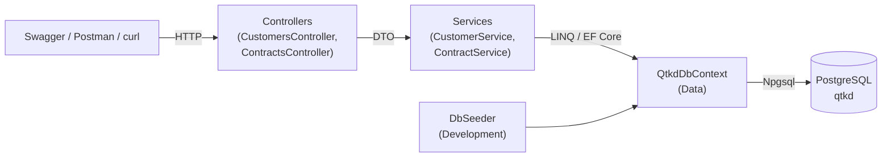
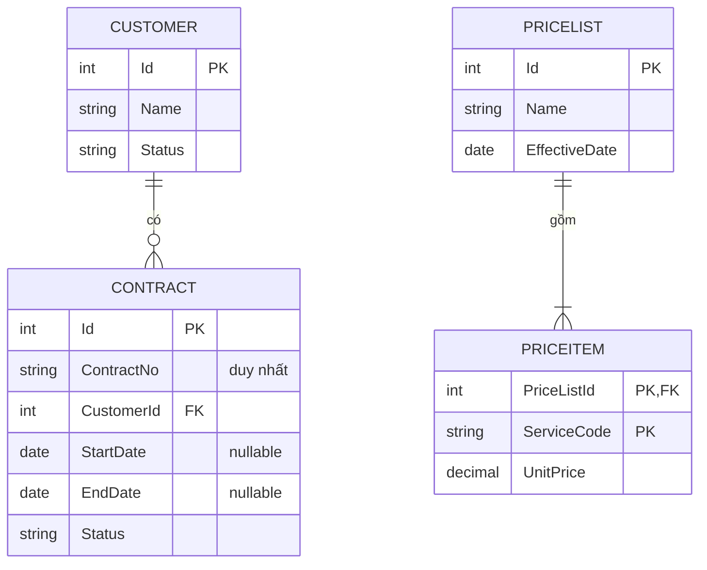

# Tuần 05 – Sơ đồ solution và danh sách minh chứng

## 1. Các thành phần chính của solution

Luồng một request: Controller nhận HTTP → gọi Service → Service truy vấn qua `QtkdDbContext`
→ PostgreSQL trả dữ liệu → Service map sang DTO → Controller trả 200 hoặc 404.

## 2. Mô hình dữ liệu

## 3. Minh chứng cần nộp cuối tuần 05

- [ ] Link repository (mã nguồn, thư mục `Migrations`, README).
- [ ] Ảnh/video ngắn: chạy API, gọi `GET /api/customers` và `GET /api/contracts/{id}`, đồng thời
      mở PostgreSQL xem dữ liệu tương ứng.
- [ ] Sơ đồ mô tả thành phần solution (mục 1 ở trên, có thể chụp từ bản render).
- [ ] Một máy/môi trường khác đã làm theo README thành công (ghi tên người/máy kiểm tra).
